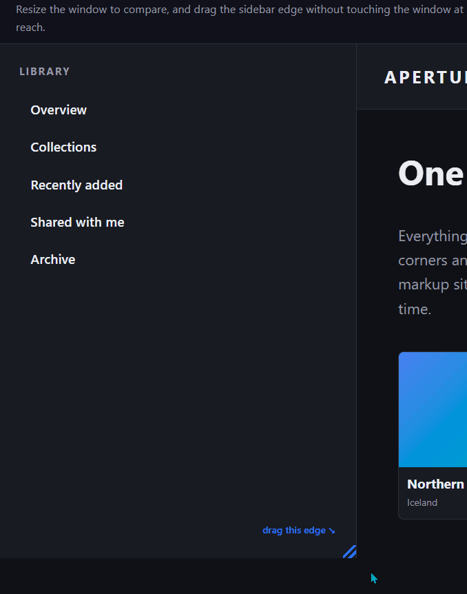
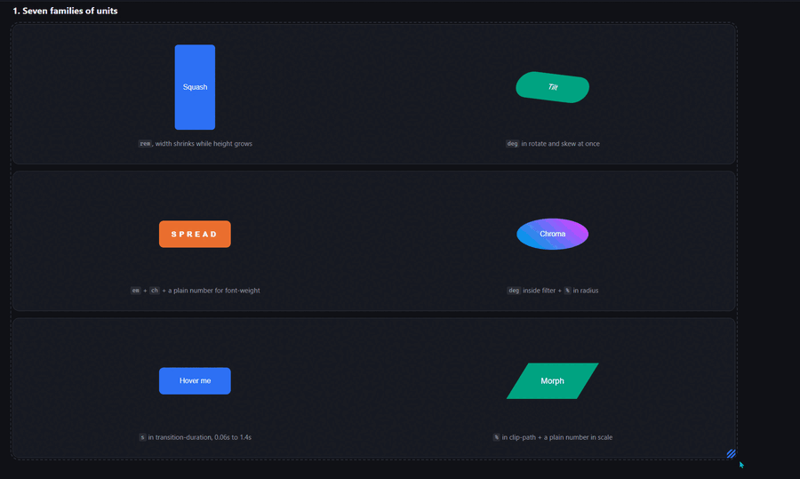

# cq-lerp

**Container-query linear interpolation.**



Drag the sidebar. The window never moves, so a media query has nothing to read.



Six properties, six unit families. 0 JavaScript, 0 keyframes, 0 width breakpoints.

Make any CSS value scale with a container's width. Degrees, seconds, font weights,
percentages, plain numbers, alongside the usual sizes.

```scss
rotate:              fluid-on(-7deg, 7deg,   var(--cq-t));
transition-duration: fluid-on(0.06s, 1.4s,   var(--cq-t));
font-weight:         fluid-on(200,   900,    var(--cq-t), "");
```

The usual fluid formula builds a line inside your own unit, so it only type-checks for
lengths: `calc(-7deg + 2cqi)` is an error. This divides two lengths to get a unitless
progress from 0 to 1, then multiplies.

CSS ships that division as
[`progress()`](https://developer.mozilla.org/en-US/docs/Web/CSS/Reference/Values/progress),
and it is **brand new**: Chrome 138, Safari 26, Firefox 155. In practice that means browsers
from 2026 onward. This library uses `progress()` where it exists and falls back to a
`clamp()` expression everywhere else, which is what makes it usable today.

MIT.

## Demos

**`examples/index.html`** builds the same app shell twice, once with this library and once
with `clamp()` plus `vw` plus media queries, and lets you flip between them in place. The
sidebar is resizable: drag its edge and watch its contents respond in one version and sit
still in the other, while the window never moves.

**`examples/units.html`** is the reference for which CSS units the interpolation handles.

## Install

```bash
npm i cq-lerp
```

Two entry points, pick one. Plain CSS needs no build:

```js
import "cq-lerp/css";               // bundler
```
```html
<link rel="stylesheet" href="node_modules/cq-lerp/dist/cq-lerp.css">
```

SCSS, if you want the helpers:

```scss
@use "cq-lerp" as *;                // sass --load-path=node_modules
```

## Plain CSS, no build

Put `.cq-lerp` on a container, then multiply anything by `var(--cq-t)`:

```css
.panel .badge {
  rotate:  calc(0deg + 45deg * var(--cq-t));
  padding: calc(12px + 12px * var(--cq-te));
}
```

`--cq-t` is linear, `--cq-te` is smoothstep. Change the range with two lengths:

```css
.panel { --cq-floor: 375px; --cq-ceil: 1440px; }
```

Use `.cq-lerp-track` when the element is already a container.

## SCSS

Writes the arithmetic for you: give it the two ends and it works out the difference, the
sign and the unit.

```scss
@use "cq-lerp" as *;

.panel { @include cq-track(); }
.panel .badge { rotate: fluid-on(-7deg, 7deg, var(--cq-te)); }

.standalone { padding: fluid(12px, 24px); }
```

| | |
| --- | --- |
| `cq-track($floor, $ceil)` | mixin: declares `--cq-t` and `--cq-te` with the `progress()` upgrade |
| `fluid-on($min, $max, $t, $unit)` | `calc(base + range * progress)` |
| `fluid($min, $max, $floor, $ceil, $unit)` | standalone, bakes in its own `clamp()` track |
| `fluid-track()` / `fluid-track-native()` | the track expression on its own |
| `fluid-ease($t)` | smoothstep |

Configure at import: `@use "cq-lerp" as * with ($cq-floor: 375, $cq-ceil: 1440)`. A bare
number means pixels. Floor and ceil must share a unit here, because Sass does the subtraction
at compile time.

## Gotchas

- **Bounds are container widths, and the ceiling is where scaling stops.** Because the box
  that has to reach it is usually a content column, a high ceiling means most things never
  arrive at their declared maximum.
- **Bounds are lengths, and units survive.** `--cq-floor: 20rem` is resolved by the browser at
  its real root font size, so a user who scales their text keeps the range you meant. A bare
  number in the CSS file makes `--cq-t` invalid and every declaration reading it drops to its
  initial value, silently. In SCSS a bare number is read as pixels.
- **The progress variable re-resolves per user.** Declare it on an outer container, read it
  inside a nested `container-type` element, and you get two different values. Handy for
  per-component progress, surprising when you expect one shared number.
- **Two different browser floors.** The `progress()` path needs Chrome 138 / Safari 26 /
  Firefox 155, all from 2025-2026. The `clamp()` fallback needs only container query units and
  length-by-length division inside `calc()`, which shipped in Chrome 119, Safari 17 and
  Firefox 116 back in 2023. Below that second floor there are no `@supports` guards and the
  declarations are dropped.
- **Nothing animates over time.** Values recompute on layout, the way `width: 50%` does.

## Prior art

The pieces are all older than this repo.
[`progress()`](https://developer.mozilla.org/en-US/docs/Web/CSS/Reference/Values/progress)
standardises the core trick. Length-by-length division is CSS Values 4, written up by
[Typetura](https://typetura.com/blog/unit-division-with-css-and-fallbacks/).
[MadeByMike](https://www.madebymike.com.au/writing/interpolation-without-animation/)
documented the limitation this works around.
[`@lunelson/sass-lerp`](https://github.com/lunelson/sass-lerp) has done calc-based Sass
interpolation for years, and [Utopia](https://utopia.fyi/) is where most people met fluid
interpolation. Assembled here: the container-driven track, the fallback, the unit inference
and the ergonomics.

## Credit

The idea of a container-based fluid engine, and the `useclamp-*` naming that started this,
come from **Zeus CSS** by Stavros Lazaris, as observed in **v1.0.12**:
[zeuscss.com](https://www.zeuscss.com/) ·
[npm](https://www.npmjs.com/package/zeus-css). Written from scratch, no code copied, no
dependency on it. The version is pinned because Zeus is under active development.
